# Microfat CLI & Launcher Stub Reference

[**← Architecture Specification**](architecture.md) | [**Main Index**](../README.md#documentation-guide) | [**Container Runtime Tuning →**](runtime-tuning.md)

---

This document provides an exhaustive reference for the `microfat` developer and CI CLI toolkit, as well as the runtime launcher stub (`microfat-stub`) meta-commands, flags, exit codes, and environment variable controls.

The separate native `microfat-install` bootstrap helper is documented in the
[installation guide](installation.md). It selects a product with `--version`, reports its own build
with `--helper-version`, supports explicit roots/system mode, repair, downgrade and uninstall, and
authenticates locally staged signed releases with `--release-dir`. It is not a `microfat update`
subcommand or a fourth installed public binary.

---

## 1. Overview & Tooling Architecture

`microfat` distributes two main command-line interfaces:

1. **`microfat`**: The primary developer CLI used during build, packaging, inspection, validation, container preparation, and environment testing.
2. **`microfat-stub`**: The lightweight launcher binary prefixed to packaged fat executables. It intercepts execution at launch time, auto-detects host microarchitecture, configures Linux container resource limits, and handles reserved meta-commands (`--microfat:*`).

```mermaid
flowchart TD
    subgraph DeveloperWorkflows ["Developer & CI Workflows (cmd/microfat)"]
        A["microfat pack / pgo-pack"] --> Fat["fat-executable"]
        B["microfat doctor"] --> Diag["Environment Health Report"]
        C["microfat inspect"] --> Manifest["Index Manifest"]
        D["microfat verify"] --> Integrity["Payload Checksums"]
        E["microfat trim"] --> Trimmed["Single-Variant Fat Binary"]
        F["microfat prewarm"] --> PrewarmedCache["$XDG_CACHE_HOME/microfat"]
    end

    subgraph RuntimeDispatches ["Runtime Execution (cmd/microfat-stub)"]
        Fat -->|./fat-executable args...| Dispatch{"Meta-Command or Execution?"}
        Dispatch -->|Standard auto Execution| ExistingCache{"Existing verified cache?"}
        ExistingCache -->|Hit| CachedExec["Execute verified cache descriptor"]
        ExistingCache -->|Miss| RAM["Verified sealed memfd"]
        Dispatch -->|--microfat:info| Info["Host & Binary Diagnostics"]
        Dispatch -->|--microfat:prewarm| Cache["Node Cache Prewarm"]
        Dispatch -->|--microfat:trim| InPlaceTrim["Trim in-place (-50% disk)"]
        Dispatch -->|--microfat:optimize| NativeELF["Raw Native ELF (no launcher)"]
    end
```



---

## 2. Developer CLI Commands (`microfat`)

### Global Flags

| Flag | Shorthand | Type | Default | Description |
| :--- | :--- | :--- | :--- | :--- |
| `--version` | `-v` | `bool` | `false` | Display version, commit, build date, and vendor metadata. |
| `--help` | `-h` | `bool` | `false` | Show command help and usage instructions. |

---

### `microfat detect`

Detect the local host CPU microarchitecture level, supported vector extensions, and CPU features.

```bash
# Human-readable output
microfat detect

# Machine-readable JSON output
microfat detect --json
```

#### Flags
| Flag | Shorthand | Type | Default | Description |
| :--- | :--- | :--- | :--- | :--- |
| `--json` | *(none)* | `bool` | `false` | Output results in formatted JSON. |

#### Example JSON Output:
```json
{
  "os": "linux",
  "arch": "amd64",
  "level": "v3",
  "features": [
    "cx16",
    "popcnt",
    "sse3",
    "ssse3",
    "sse4.1",
    "sse4.2",
    "avx",
    "avx2",
    "bmi1",
    "bmi2",
    "fma",
    "osxsave"
  ]
}
```

---

### `microfat doctor`

Verify the local host runtime environment readiness for high-performance Microfat dispatch, checking CPU capabilities, in-memory execution (`memfd_create`), disk cache execution permissions, and Linux container cgroup limits.

```bash
# Standard environment inspection
microfat doctor

# Machine-readable JSON output (recommended for CI/CD gates)
microfat doctor --json

# Strict mode (fails if memfd_create is unavailable)
microfat doctor --strict

# Custom cache directory audit
microfat doctor --cache-dir /var/cache/microfat
```

#### Flags
| Flag | Shorthand | Type | Default | Description |
| :--- | :--- | :--- | :--- | :--- |
| `--json` | *(none)* | `bool` | `false` | Output complete diagnostic report in JSON. |
| `--cache-dir` | *(none)* | `string` | *(unset)* | Custom disk cache directory path to probe and verify. |
| `--strict` | *(none)* | `bool` | `false` | Require both `memfd_create` and disk cache to be functional; fail if either is blocked. |

#### Human-Readable Output:
```text
=== Microfat Host Environment Doctor ===

[✔] Host CPU Microarchitecture
    • OS/Arch:        linux/amd64
    • Detected Level: v3
    • Key Features:   cx16, popcnt, sse3, ssse3, sse4.1, sse4.2, avx, avx2, bmi1, bmi2, fma, osxsave
    • AVX-512 Status: not present (no downclock risk)

[✔] In-Memory Execution (memfd_create)
    • Kernel Support: Available (Linux 6.8.0-generic)
    • Seccomp Filter: Permitted

[✔] Disk Cache Execution Fallback
    • Resolved Path:  /home/deployer/.cache/microfat
    • Permissions:    0700 (read/write OK)

[✔] Container Resource Limits (cgroup v2)
    • Memory Limit:   2147483648 B (2.00 GiB)
    • CFS CPU Quota:  4.00 cores
    • Auto GOMEMLIMIT: 1932735283 B (~1.80 GiB)
    • Auto GOMAXPROCS: 4

[✔] Toolchain & Version Metadata
    • Version:        v0.2.1
    • Commit:         7cba82c
    • Build Date:     2026-09-02T20:00:00Z

Summary: Environment is fully ready for high-performance Microfat dispatch!
```

---

### `microfat inspect <binary>` (alias: `microfat info`)

Inspect embedded variants, format version, dictionary metadata, uncompressed/compressed sizes, and platform targeting inside an existing fat binary.

```bash
# Standard table inspection
microfat inspect bin/myapp

# Or using the 'info' alias
microfat info bin/myapp

# JSON inspection
microfat inspect bin/myapp --json
```

> [!WARNING]
> **Format v1 Deprecation**: Inspecting binaries packed with the legacy Format v1 JSON manifest displays a deprecation warning on stderr. Format v1 will be removed in a future release. Please repack using Format v2 (the default).

#### Flags
| Flag | Shorthand | Type | Default | Description |
| :--- | :--- | :--- | :--- | :--- |
| `--json` | *(none)* | `bool` | `false` | Output binary index manifest in JSON. |

#### Example Output:
```text
Binary Path:       bin/myapp
App Name:          myapp
Format Version:    v2 (compact binary table)
Target Platform:   linux/amd64
Total Size:        12582912 bytes
Shared Dictionary: 114688 bytes (offset 3254120, sha256: 8f3c4e1b...)
Created At:        2026-08-28T02:30:00Z
Created Unix:      1787884200

Embedded Variants (3 total):
  • v1     [zstd] offset:    3368808 | comp:    2945120 B | raw:    7397639 B (39.8%) | sha256: f4e7f675b059...
  • v3     [zstd] offset:    6313928 | comp:    2891240 B | raw:    7389447 B (39.1%) | sha256: fda5c10d86f6...
  • v4     [zstd] offset:    9205168 | comp:    2892110 B | raw:    7389447 B (39.1%) | sha256: 56b5656ccdd1...
```

`Created Unix` and JSON `created_unix` preserve the exact signed integer epoch. `Created At`
shows its UTC RFC3339 calendar representation for years 0000 through 9999, or `unavailable`
outside that range. The creation epoch is caller-supplied metadata, not proof of producer
identity or a measurement of when the build actually ran.

---

### `microfat verify <binary>`

Validate the 56-byte trailer magic, index SHA-256 hash, and payload integrity checksums of all embedded variants.

Both text and `--json` modes exit nonzero if any variant is invalid. JSON mode emits the
structured result to stdout before reporting an integrity failure on stderr. A malformed
index can fail before a structured result is available. Successful integrity verification
does not certify executable ELF structure or runtime compatibility.

```bash
# Verify binary integrity
microfat verify bin/myapp

# JSON output for CI pipeline checks
microfat verify bin/myapp --json
```

#### Flags
| Flag | Shorthand | Type | Default | Description |
| :--- | :--- | :--- | :--- | :--- |
| `--json` | *(none)* | `bool` | `false` | Output verification results in structured JSON format. |

#### Exit Code Behavior:
- `0`: All embedded payloads and trailers matched their SHA-256 payload integrity checksums.
- `1`: One or more variants failed verification or trailer was corrupted.

> [!NOTE]
> `microfat verify` performs payload and index integrity validation (detecting bit-rot, transmission corruption, and partial tampering). It does not authenticate the producer of the fat binary; publisher authenticity requires external signature verification before first execution. See [SECURITY.md](../SECURITY.md#6-payload-integrity-vs-producer-authenticity-hashing-vs-signing).

---

### `microfat pack`

Package multiple pre-compiled microarchitecture-specific ELF binaries into a self-dispatching fat executable.

The stub and variants must be nonempty regular files (symlinks to regular files are supported).
Inputs are opened without waiting for FIFO peers and validated through their open descriptors.
Each packaging input is limited to 1 GiB and snapshotted before validation and compression.
ELF validation accepts 64-bit `ET_EXEC` and `ET_DYN` executables, including dynamically linked
executables and PIE/static PIE, with an entry point in a file-backed executable load segment.
Relocatable objects, core dumps and nonexecutable shared libraries are rejected before replacing
any output. This does not certify interpreter/libc compatibility across variants.
Validation checks ELF and program headers plus section-table bounds, without reading section
contents or resolving section names. Compressed auxiliary metadata cannot force decompression
or repeated name allocations during this check; malformed unused section contents are outside
its execution contract.
`--skip-elf-validation` bypasses ELF structure checks only; regular-file, size and snapshot
checks still apply, and a bypassed input is not guaranteed to execute.

```bash
# AMD64 packaging (launcher stub auto-discovered from same directory or $PATH)
microfat pack \
  --name myapp \
  -v v1=dist/app_v1 \
  -v v3=dist/app_v3 \
  -v v4=dist/app_v4 \
  -o bin/myapp

# Or explicitly specifying launcher stub path
microfat pack \
  --stub bin/microfat-stub \
  --name myapp \
  -v v1=dist/app_v1 \
  -v v3=dist/app_v3 \
  -v v4=dist/app_v4 \
  -o bin/myapp

# ARM64 packaging with shared dictionary compression
microfat pack \
  --stub bin/microfat-stub-arm64 \
  --name myapp \
  --arch arm64 \
  --dict \
  -v v8.0=dist/app_arm64_v80 \
  -v v8.2=dist/app_arm64_v82 \
  -v v9.0=dist/app_arm64_v90 \
  -o bin/myapp-arm64

# Declarative build using manifest file
microfat pack --manifest pgo.yaml -o bin/myapp
```

#### Flags
| Flag | Shorthand | Type | Default | Description |
| :--- | :--- | :--- | :--- | :--- |
| `--stub` | *(none)* | `string` | `""` | Path to launcher stub binary. Takes precedence over automatic discovery; if omitted, evaluates strict precedence: manifest `stub:`, sibling companion stub, then absolute PATH directories matching `--stub-profile`. |
| `--stub-profile` | *(none)* | `string` | `""` | Launcher stub profile: `full` (default, selects `microfat-stub`) or `minimal` (selects `microfat-stub-minimal`). |
| `--output` | `-o` | `string` | `""` | Destination output path for the packaged fat executable. |
| `--name` | *(none)* | `string` | `""` | Valid UTF-8 application name embedded in manifest. |
| `--os` | *(none)* | `string` | `"linux"` | Target operating system. |
| `--arch` | *(none)* | `string` | `"amd64"` | Target architecture (`amd64` or `arm64`). |
| `--variant` | `-v` | `stringArray` | `[]` | Variant mapping in `<level>=<path>` format (e.g. `-v v1=bin/v1 -v v3=bin/v3`). |
| `--profile` | *(none)* | `string` | `""` | Compression profile preset: `latency`, `balanced`, `size`. |
| `--compression` | *(none)* | `string` | `""` | Compression algorithm: `zstd`, `lz4`, `none` (e.g. `zstd:11`). |
| `--compression-level` | *(none)* | `string` | `""` | Compression level override: `fastest`, `default`, `better`, `best`, or number. |
| `--variant-compression` | *(none)* | `stringArray` | `[]` | Override one supplied variant with `<level>=<codec>[:<compression-level>]`; repeat for multiple variants. Available for direct `pack`, `pack --manifest`, and `pgo-pack`. |
| `--dict`, `--zstd-dict` | *(none)* | `bool` | `false` | Enable shared Zstandard inter-variant dictionary compression. |
| `--dict-size` | *(none)* | `int` | `114688` | Target shared dictionary size in bytes (default: 112 KB). |
| `--format-version` | *(none)* | `int` | `2` | Binary format version: `2` (compact binary table, default) or `1` (legacy JSON, deprecated). |
| `--skip-elf-validation` | *(none)* | `bool` | `false` | Skip ELF architecture, executable type, load segment and entry-point checks. |
| `--manifest` | `-m` | `string` | `""` | Path to YAML or JSON declarative build manifest. |
| `--concurrency` | `-j` | `int` | `NumCPU` | Concurrent compiler workers when building via manifest. |
| `--keep-intermediates` | *(none)* | `bool` | `false` | Retain intermediate compiled variant binaries when building via manifest. |
| `--go-binary` | *(none)* | `string` | `""` | Path to custom Go toolchain binary (defaults to `$GO` or `go`). |

#### Reproducible Creation Epoch

Direct `pack`, `pack --manifest`, and `pgo-pack` read
[`SOURCE_DATE_EPOCH`](https://reproducible-builds.org/specs/source-date-epoch/) once before
building or snapshotting packaging inputs. When absent, new packages retain wall-clock Unix
seconds. When present, the value must be an ASCII decimal integer with an optional `+` or `-`
sign that fits `int64` (`-9223372036854775808` through `9223372036854775807`). Zero and
pre-1970 epochs are accepted. Empty values, whitespace, fractions, non-ASCII digits and overflow
fail with an error before packaging changes output files. An already exported value is
preserved for compiler/build children, taking precedence over manifest `env` entries for this
variable. When the ambient variable is absent, a manifest `env` entry remains a build-child
setting and does not select the package creation epoch.

```bash
# Reuse one epoch for every packaging operation in this build.
export SOURCE_DATE_EPOCH=1787884200
microfat pack --stub bin/microfat-stub -v v1=dist/app_v1 -o bin/myapp
microfat pack --manifest pgo.yaml -o bin/myapp-manifest
microfat pgo-pack --manifest pgo.yaml -o bin/myapp-pgo
```

With identical stub/payload bytes, effective compression settings, dictionary inputs, epoch,
other metadata/options, and pinned toolchain/codec, repeated packaging produces identical
complete bytes and SHA-256.
The same epoch is preserved in Format v1 and v2. This controls new package metadata; it does
not normalize ELF build IDs, source paths, compiler provenance or signatures, and does not
guarantee identical arbitrary source builds or output across different toolchains/codecs.
Trim/optimize transformations retain their existing timestamp and filesystem metadata policies.

Internal Go callers can set `pack.Options.CreatedUnix` to an `*int64`; nil selects wall-clock
seconds and a pointer to zero selects epoch zero. Core `Pack` resolves this option once and
does not read `SOURCE_DATE_EPOCH` itself.

#### Compression Precedence and Profile Resolution Contract

Use repeated `--variant-compression <level>=<codec>[:<compression-level>]` flags to mix
`none`, `lz4`, and `zstd` in one executable:

```bash
microfat pack --stub bin/microfat-stub \
  -v v1=dist/app_v1 -v v2=dist/app_v2 -v v3=dist/app_v3 \
  --variant-compression v1=none \
  --variant-compression v2=lz4:fastest \
  --variant-compression amd64_v3=zstd:best -o bin/myapp

# The same overrides apply when the manifest builds the variants.
microfat pgo-pack --manifest pgo.yaml --variant-compression v3=zstd:best -o bin/myapp-pgo
```

Variant keys accept the same normalized aliases as `--variant`, including `V3`,
`amd64_v3`, and `arm64-v8.2`. Each key must belong to the selected architecture and
refer to a supplied direct or manifest variant. Repeated keys, including different
aliases for the same variant, are rejected. Missing keys/codecs, extra separators,
unknown codecs, unsupported inline levels and a trailing empty `:` are rejected before
compilation or packaging. `none` accepts no inline compression level.

Codec names and named compression levels are case-insensitive. The level mappings
match the existing codec encoders:

| Codec | Accepted compression levels |
| :--- | :--- |
| `zstd` | `fastest`/`fast`/`speed`; `default`/`standard`; `better`; `best`/`max`. Integers up to 1 select `fastest`, 2 selects `default`, 3–9 select `better`, and 10 or above select `best`. |
| `lz4` | `fastest`/`fast`/`default` select fast mode; `better` selects level 5; `best`/`max` select level 9. Integers up to 0 select fast mode, 1–8 select that level, and 9 or above select level 9. |
| `none` | No level; payload bytes are stored uncompressed. |

Numeric levels accept leading zeros, a plus or minus sign, and surrounding
whitespace. Zstandard numbers select microfat encoder presets.

Algorithm, compression level and profile are resolved separately for each variant:

1. The algorithm comes from `--variant-compression`, then the manifest variant's
   `compression.algorithm`, then global `--compression`, then root manifest
   `compression.algorithm`. The first supplied algorithm wins.
2. A variant CLI inline level overrides that variant's manifest level. A
   **codec-only** variant CLI override preserves its manifest's separate
   `compression.level` and `compression.profile` fields. It replaces the entire
   `compression.algorithm` field, including any inline level in that field.
3. Without a variant CLI inline level, the variant's separate `compression.level`
   outranks an inline level in its effective variant algorithm. Either outranks
   the global level. A codec-only variant algorithm inherits the global level
   when the variant has no separate level.
4. The inherited global level comes from `--compression-level`, then an inline
   level in CLI `--compression`, then root manifest `compression.level`. An inline
   level in root manifest `compression.algorithm` remains part of that field:
   replacing its algorithm with a global or variant override replaces that inline
   level too. Codec-only overrides retain a separate root level.
5. The profile comes from the manifest variant's `compression.profile`, then
   global `--profile`, then root manifest `compression.profile`, then `balanced`.
   When the algorithm is absent, `latency` selects `none` for positive payload
   sizes below 512 KiB (524,288 bytes), otherwise `lz4`; `size` and `balanced`
   select `zstd`. An omitted Zstandard level defaults to `best` with `size` or
   `better` with `balanced`; `latency` uses the codec default.

For example, a manifest variant with `compression: {algorithm: zstd, level: best}`
and `--variant-compression v3=lz4` uses LZ4 level 9. Adding `:fastest` to that CLI
override selects LZ4 fast mode. A global `--compression=lz4` does not replace a
manifest variant's explicit algorithm.

Both Format v1 and v2 and the full and minimal launcher stubs support mixed codecs
in `memfd` and `cache` execution modes. `--dict` (or manifest `compression.dict`)
forces shared Zstandard dictionary training across the supplied payloads and
requires at least two variants; only Zstandard frames consume the dictionary.
The root `size` profile attempts automatic dictionary training when at least two
variants are supplied and at least one resolves to Zstandard. If every variant
resolves to `none` or `lz4`, no dictionary is trained automatically. Automatic
training failure emits a warning and falls back to independent frames; explicit
dictionary requests fail on training errors. Codec overrides leave dictionary
settings in place, and explicit dictionary requests retain dictionary metadata
even when all variants use `none` or `lz4`.

The following manifest fragment illustrates omitting algorithms while selecting profiles at root and variant scopes:

```yaml
# Manifest fragment (illustrates profile selection with omitted algorithms)
target_arch: amd64
compression:
  profile: balanced
variants:
  - level: v1
    compression:
      profile: latency
```

#### Launcher Stub Profile Selection Contract

`microfat` packages fat binaries using either the standard full launcher stub or the lightweight minimal launcher stub:

- **`full` Profile (`microfat-stub`, default)**: Includes interactive runtime meta-commands (`--microfat:info`, `--microfat:optimize`,
  `--microfat:trim`, etc.), container resource auto-tuning, zero-allocation binary table decoding, and in-RAM/cache dispatch.
- **`minimal` Profile (`microfat-stub-minimal`)**: Compiled with `-tags minimal` with meta-command handlers stripped for a reduced footprint.
  Retains container resource auto-tuning, zero-allocation binary table decoding, in-RAM/cache dispatch, and environment controls such as
  `MICROFAT_FORCE_LEVEL`, `MICROFAT_EXEC_MODE`, and `MICROFAT_GC_PROFILE`, but explicitly rejects interactive meta-commands (`--microfat:*`).
  Stub size depends on architecture, Go toolchain, and build flags; measure the selected artifact rather than assuming a fixed size limit.

**Resolution & Conflict Contract**:
1. **Explicit `--stub <path>`**: Takes deliberate precedence over profile auto-discovery.
2. **Explicit `--stub-profile <full|minimal>`**: Selects the companion stub binary name (`microfat-stub` or `microfat-stub-minimal`)
   for auto-discovery in the sibling directory or `$PATH`.
3. **Explicit Conflict Enforcement**: If an explicit stub path contradicts an explicitly requested profile (e.g. `--stub microfat-stub`
   with `--stub-profile minimal`, or manifest `stub: microfat-stub` with `stub_profile: minimal`), `microfat` terminates execution
   immediately with an explicit conflict error.
4. **Non-Executing Candidate Inspection**: Companion candidate inspection verifies regular file status, executable permissions, ELF magic
   bytes (`\x7fELF`), and machine architecture compatibility (`EM_X86_64` vs `EM_AARCH64`) without executing unverified binaries.

---

### `microfat pgo-pack`

Compile and package multiple microarchitecture variants with Profile-Guided Optimization (`-pgo`) profiles concurrently in a single step using a declarative YAML/JSON manifest.

Both `pgo-pack` and `pack --manifest` anchor the manifest directory before starting
the compiler. Per-variant `pgo` and top-level `default_pgo` paths are relative to
that directory; automatic `default.pgo` discovery uses the package directory.
Relative and absolute manifest arguments work from other working directories,
including paths containing spaces. Profile paths preserve leading and trailing
whitespace in quoted values. The exact value `off` (case-insensitive) disables
profile discovery; an empty value uses the default profile fallback. `pgo: off`
disables profile discovery for that variant. Manifest-relative output placement
and explicit `--stub` precedence apply as before.

A manifest's `compression.dict_size` is retained unless `--dict-size` is explicitly
supplied. Omitting the size from both sources uses the normal 112 KiB default.

```bash
microfat pgo-pack --manifest pgo.yaml -o bin/myapp
```

#### Manifest Schema (`pgo.yaml`):
```yaml
name: payment-service
package: ./cmd/payment-service
output: bin/payment-service
stub: bin/microfat-stub
target_os: linux
target_arch: amd64
default_pgo: profiles/baseline.pgo
build_flags:
  - "-trimpath"
  - "-ldflags=-s -w"
variants:
  - level: v1
    pgo: "off"
  - level: v3
    pgo: profiles/v3.pgo
  - level: v4
    pgo: profiles/v4.pgo
```

#### Flags
Accepts the manifest and compiler flags matching `microfat pack`: `--manifest`,
`-o`, `--stub`, `--stub-profile`, `--concurrency`, `--profile`, `--compression`,
`--compression-level`, repeated `--variant-compression`, `--dict`/`--zstd-dict`,
`--dict-size`, `--format-version`, `--keep-intermediates`, `--go-binary`, and
`--skip-elf-validation`. Per-variant CLI compression overrides follow the same
precedence contract above for `pgo-pack` and `pack --manifest`.

> [!NOTE]
> **Authoritative Target Policy**: `GOOS`, `GOARCH`, `GOAMD64`, and `GOARM64` are reserved target variables. Ambient values for these variables are sanitized during compilation. Contradictory values declared in manifest `env` (at root or variant level) are rejected before compilation begins. In addition, every compiled Go artifact is validated via `debug/buildinfo` prior to packaging to ensure binary settings match declared variant levels.

---

### `microfat trim <binary>`

Trim unneeded microarchitecture variants from a fat binary, retaining the launcher stub, container auto-tuning, and the selected compatible level on disk.

```bash
# In-place trimming to host microarchitecture level (-50% disk footprint)
microfat trim bin/myapp

# Trim to explicit target level and output path
microfat trim bin/myapp --level v3 -o bin/myapp-v3

# Trim applying max ceiling and safe downclock policy
microfat trim bin/myapp --max-level v3 --policy safe_avx512 -o bin/myapp-safe
```

#### Flags
| Flag | Shorthand | Type | Default | Description |
| :--- | :--- | :--- | :--- | :--- |
| `--output` | `-o` | `string` | `""` | Destination output path (defaults to in-place replacement). |
| `--level` | *(none)* | `string` | `""` | Target level to retain (defaults to auto-detected host level). |
| `--max-level` | *(none)* | `string` | `""` | Maximum microarchitecture level ceiling to retain. |
| `--disable-variants` | *(none)* | `string` | `""` | Comma-separated list of variant levels to exclude. |
| `--policy` | *(none)* | `string` | `""` | Policy preset name (`safe_avx512`, `no_downclock`). |
| `--metadata-policy` | *(none)* | `string` | `"strict"` | Metadata policy (`strict`, `strip`). Strict preserves exact owner, mode, and supported xattrs; strip discards extra metadata. |
| `--break-hardlinks` | *(none)* | `bool` | `false` | Allow in-place mutation of files with multiple hard links by breaking link and replacing only the invoked path. |

---

### `microfat prewarm <binary>`

Pre-extract payload variants into the local node cache (`$XDG_CACHE_HOME/microfat`) to avoid
decompression on a verified warm hit. Default auto mode uses existing cache entries without an
execution-mode override. Verification, launcher work and normal ELF startup still apply.

```bash
# Prewarm selected compatible variant into cache
microfat prewarm bin/myapp

# Prewarm all embedded variants (for multi-tenant cache partitions)
microfat prewarm bin/myapp --all

# Prewarm to custom cache path
microfat prewarm bin/myapp --cache-dir /var/cache/microfat

# Verify cache health without re-extracting
microfat prewarm bin/myapp --verify

# Inspect selected work without changing the cache
microfat prewarm bin/myapp --all --plan --cache-dir /var/cache/microfat

# Plan and then apply a 32 MiB logical selected-payload budget
microfat prewarm bin/myapp --all --plan --json --max-payload-bytes=33554432 \
  --cache-dir /var/cache/microfat
microfat prewarm bin/myapp --all --max-payload-bytes=33554432 \
  --cache-dir /var/cache/microfat

# Structured JSON output for initContainers
microfat prewarm bin/myapp --json
```

#### Flags
| Flag | Shorthand | Type | Default | Description |
| :--- | :--- | :--- | :--- | :--- |
| `--level` | `-l` | `string` | `""` | Specific variant level to prewarm (defaults to selected compatible). |
| `--all` | *(none)* | `bool` | `false` | Prewarm all embedded variants into the cache directory. |
| `--cache-dir` | *(none)* | `string` | `""` | Custom cache directory path. |
| `--verify` | *(none)* | `bool` | `false` | Verify existing cache entries without creating directories, repairing permissions, extracting, or removing entries. |
| `--plan` | *(none)* | `bool` | `false` | Report selected declarations, read-only cache checks and materialization prerequisites without extracting or executing payloads. |
| `--max-payload-bytes` | *(none)* | `decimal bytes` | unlimited | Admit at most this many unique selected raw payload bytes, independently of cache state. |
| `--json` | *(none)* | `bool` | `false` | Output results in JSON telemetry format. |

`--all` and `--level` are mutually exclusive. Omit both to select the host-compatible variant.
Explicit `--level` and `--all` can stage supported foreign-architecture payloads without executing
them. Unsupported target architectures fail. `--plan` and `--verify` are mutually exclusive;
`--max-payload-bytes` works with planning, verification and extraction. These two new flags apply
to the CLI only; the embedded launcher interface is unchanged.

The byte limit accepts one or more ASCII decimal digits in the range `0` through
`18446744073709551615`; signs, whitespace, units, fractions, hexadecimal and empty values fail.
The exact limit is admitted. Explicit zero rejects every nonempty selection. Omission preserves
unlimited admission. SHA-256 identities shared by several selected levels count once; conflicting
declared sizes and arithmetic overflow fail. The limit is checked before cache discovery,
directory creation, permission repair, temporary files or extraction. An oversized request fails
without partial materialization, even if every selected payload is already cached.

This is a logical selected-payload cap, not a filesystem quota, free-space check or reservation.
It excludes filesystem metadata, temporary and replacement overlap, other processes, sparse or
compressed filesystem allocation, and RSS. A later operational failure can leave earlier entries
successfully materialized; this is not a multi-entry transaction. On such a failure, prewarm emits
completed results and a failing exit status. JSON `results` contains only completed entries.

Planning never creates, repairs, chmods, removes or replaces cache entries or directories. It
validates the source index and shared dictionary, and checks existing entries by opening and
hashing their descriptors with the normal size, ownership, mode and SHA-256 requirements. This
performs reads and hashing. Reported payload hashes and raw sizes are validated index declarations,
not verification of embedded payload contents. Authenticate or verify the whole artifact separately.
Every observation can become stale immediately; a later prewarm invocation revalidates its own
opened descriptors and retains normal atomic publication and error handling.

An explicit missing cache directory is reported as planned work without creating it. Automatic
discovery uses existing secure directories; when none can be securely identified, the plan reports
`unavailable` and an empty `cache_path`, rather than guessing a future extraction destination.
Read-only automatic discovery can observe an existing fallback directory while a later mutating
resolution creates or repairs a primary directory and uses a different path with different cache
totals. Supply the same explicit `--cache-dir` to review and apply the same destination; its state
can still change between invocations.
Cache state and decoder availability are independent: a descriptor-verified cache hit can be reused
even if its embedded codec is unavailable.

#### Plan JSON vocabulary

`--plan --json` emits `event: "prewarm_plan"`, `app_name`, `target_os`, `target_arch`, the following
totals, and an `entries` array. All sizes are integer bytes. Each total deduplicates selected SHA-256
identities; `entries` still lists every selected level. Existing extraction and `--verify` JSON keep
their `event: "prewarm"` shape when `--plan` is absent, including when a cap is supplied.

| Field | Meaning |
| :--- | :--- |
| `unique_payload_count` | Number of distinct selected SHA-256 identities. |
| `unique_payload_bytes` | Sum of their index-declared raw sizes; the admission limit uses this total. |
| `verified_cache_bytes` | Logical bytes whose existing descriptors passed mandatory validation. |
| `needs_materialization_bytes` | Declared logical bytes with cache status `missing` or `corrupt_safe`, including when their decoder is unavailable. |
| `blocked_payload_bytes` | Declared logical bytes with cache status `unsafe` or `unavailable`. |

| Entry field | Meaning |
| :--- | :--- |
| `level`, `sha256`, `uncompressed_size` | Selected level and validated index-declared identity and raw bytes. |
| `cache_path` | Observed or explicit destination pathname; empty when discovery could not identify one. |
| `cache_status` | `valid`, `missing`, `corrupt_safe`, `unsafe` or `unavailable`, as described below. |
| `cache_error` | Explanation of a failed cache observation; omitted when empty. |
| `decoder_available`, `decoder_error` | Whether the CLI has the declared codec, and an optional explanation when it does not. |
| `materialization_possible` | Whether known decoder and cache safety prerequisites permit extraction if needed; no capacity or success guarantee. |
| `can_prewarm` | Whether a verified hit, known extraction prerequisites or earlier same-identity staging can satisfy this entry. |
| `reuse_after_level` | Optional earlier selected level whose successful staging would let this entry reuse the same payload. |

`valid` requires a descriptor-verified executable entry. `missing` means an explicit directory or
entry is absent. `corrupt_safe` means a safe regular entry failed executable-mode, size or content
validation and can be replaced by explicit extraction. `unsafe` means directory or entry metadata
violates cache safety requirements, including symlinks and nonregular entries. `unavailable` means
the directory or entry could not be inspected or securely discovered; it does not claim absence.

The plan is printed before a failing exit status when any selected entry cannot prewarm, including
unsafe or unavailable cache observations and an unavailable decoder without a reusable hit or
earlier supported duplicate. A later duplicate can depend on earlier successful materialization;
`reuse_after_level` is a conditional dependency, not a reservation. A missing entry with a known
decoder normally produces a successful plan. None of these outcomes authorizes skipping validation
when applying the work.

---

## 3. Runtime Launcher Stub Meta-Commands

Every fat binary built with standard `microfat-stub` supports built-in meta-commands:

```bash
# 1. Print runtime diagnostic information
./myapp --microfat:info
./myapp --microfat:info=json

# 2. Prewarm variant into node cache and exit 0
./myapp --microfat:prewarm
./myapp --microfat:prewarm=all
./myapp --microfat:prewarm=verify

# 3. In-place trim unneeded variants on disk
./myapp --microfat:trim
./myapp --microfat:specialize
# With metadata policy options (strict default, strip, or break-hardlinks):
./myapp --microfat:trim --microfat:metadata-policy=strip --microfat:break-hardlinks

# 4. Extract single-variant fat binary to a target file
./myapp --microfat:trim-to /usr/local/bin/myapp
./myapp --microfat:specialize-to /usr/local/bin/myapp

# 5. In-place permanently specialize to raw uncompressed native ELF
./myapp --microfat:optimize
./myapp --microfat:optimize --microfat:metadata-policy=strip

# 6. Extract raw uncompressed native ELF to a target file
./myapp --microfat:optimize-to /usr/local/bin/myapp

# 7. Print launcher stub help message
./myapp --microfat:help
```

`info` reports the requested execution policy before application dispatch. Its JSON `exec_mode`
is `auto`, `cache`, or `memfd`; `auto` lists separate prospective cache and memfd plans under
`runtime.candidates`. Inspection does not choose an execution path, run the application, or populate
the cache. The memfd plan accounts for page-rounded retained executable storage.

Help and info remain available when CPU compatibility or selection policy excludes every payload.
JSON info then leaves `selected_variant` empty, reports `selection_error`, and omits prospective
runtime candidates. Explicit `prewarm=all` or `prewarm=LEVEL` can stage payloads without a host-selected
variant; plain prewarm and host-selected transformations still require compatible selection.

Each candidate separates computed tuning from `effective_environment`, which describes the
`GOMEMLIMIT`, `GOMAXPROCS`, and `GOGC` values that would reach the application. Inherited values,
including explicitly empty values, take priority. Disabled tuning and dry-run retain the computed
plan without injecting it. Cgroup observation statuses distinguish finite values from unknown
observations; a zero numeric observation does not establish that resources are unlimited.
The legacy `cgroup` tuning fields describe a computed plan only for an explicit cache or memfd policy;
use each candidate's `effective_environment` to inspect its inherited or injected values.

> [!NOTE]
> **Minimal Stub Profile (`-tags minimal`)**:
> To reduce launcher stub size, compile with `go build -tags minimal ./cmd/microfat-stub` (or use `bin/microfat-stub-minimal`). The minimal stub retains container resource auto-tuning, environment controls, zero-allocation binary table decoding, and cache-first auto/sealed memfd dispatch, but rejects interactive meta-commands (`--microfat:*`). Sizes vary with architecture, toolchain, and build flags; the published v0.3.0 Linux amd64 minimal stub is 3,748,000 bytes, compared with 3,977,376 bytes for the full stub.

---

## 4. Environment Variables Reference

### Input Configuration & Policy Controls

| Variable | Type | Default | Description |
| :--- | :--- | :--- | :--- |
| `MICROFAT_AUTOTUNE` | `bool` (`1`/`0`, `true`/`false`) | `1` | Enable automatic Linux cgroup v1/v2 limit probing and `GOMEMLIMIT`/`GOMAXPROCS` injection. |
| `MICROFAT_CPU_POLICY` | `string` (`static`/`native`) | `static` | Select fixed floor-rounded quota tuning or preserve Go's CPU policy. Native leaves `GOMAXPROCS` untouched while memory and GC tuning remain enabled. A valid value overrides `runtimeinit.WithCPUPolicy`; invalid input falls back to that option/default. See [CPU policy caveats](runtime-tuning.md#b-gomaxprocs-cpu-quota). |
| `MICROFAT_DRY_RUN` | `bool` (`1`/`0`, `true`/`false`) | `0` | Simulate cgroup auto-tuning without modifying active Go runtime state (`debug.SetMemoryLimit`, `runtime.GOMAXPROCS`, `debug.SetGCPercent`). |
| `MICROFAT_MEM_RATIO` | `float` | `0.90` | Fraction of container cgroup memory ceiling assigned to `GOMEMLIMIT` (e.g. `0.85` or `0.80`). |
| `MICROFAT_GC_PROFILE` | `string` | `default` | GC profile: `latency_critical` (75), `memory_constrained` (40), `batch_etl` (off only with a finite effective memory ceiling), `adaptive`. |
| `MICROFAT_LIVE_HEAP_ESTIMATE` | `string` | *(unset)* | Steady-state live heap size string for `adaptive` profile (e.g. `150MB`, `150MiB`, `157286400`). |
| `MICROFAT_FORCE_LEVEL` | `string` | *(unset)* | Strictly pin execution to a specific variant level (`v1`, `v2`, `v3`, `v4`, `v8.0`..`v9.5`). Fails fast if unsupported. |
| `MICROFAT_MAX_LEVEL` | `string` | *(unset)* | Cap selection ceiling to a maximum level (e.g. `v3` or `v8.2`). |
| `MICROFAT_DISABLE_VARIANTS` | `string` | *(unset)* | Comma-separated list of variant levels to exclude from selection (e.g. `v4,v9.2`). |
| `MICROFAT_POLICY` | `string` | *(unset)* | Preset dispatch policy name (`safe_avx512`, `no_downclock`). |
| `MICROFAT_AVX512_DOWNCLOCK_PROTECTION` | `bool` | `0` | Enable Intel Skylake-X/Cascade Lake Xeon downclocking mitigation. |
| `MICROFAT_EXEC_MODE` | `string` | *(unset: auto)* | Auto checks an existing verified cache entry, then sealed memfd on a miss; cold memfd denial can materialize cache. Explicit `memfd` bypasses cache and fails closed; `cache` materializes verified disk entries. |
| `MICROFAT_CACHE_DIR` | `string` | *(unset)* | Custom node cache directory path (defaults to `$XDG_CACHE_HOME/microfat`). |
| `MICROFAT_VERIFY_CACHE` | *(ignored)* | *(ignored)* | Cache size, owner, permissions and SHA-256 checks are mandatory on every hit; this variable cannot disable them. |
| `MICROFAT_LOG` | `string` | `text` | Logging mode: `text` or `json` (structured JSON telemetry on stderr). |
| `MICROFAT_DEBUG` | `bool` | `0` | Enable detailed microsecond startup and dispatch logging on stderr. |
| `GOMEMLIMIT` | `string` | *(unset)* | If already set in the environment, Microfat **never** overrides it. |
| `GOMAXPROCS` | `string` | *(unset)* | If already set in the environment, Microfat **never** overrides it. |

In auto mode, cache lookup is read-only: absent or corrupt safe regular entries remain untouched
before sealed memfd execution. Unsafe entries fail closed. A valid hit executes the verified
descriptor without source payload/dictionary decompression. If that descriptor cannot execute,
auto tries sealed memfd once and reports both failures if it fails, without another cache attempt.
Extraction corruption is terminal. See the [complete dispatch and trust contract](architecture.md#7-cache-first-auto-dispatch--descriptor-bound-execution).

---

### Exported Downstream Runtime Telemetry Variables

Whenever the launcher stub executes a payload variant, it exports runtime metadata variables to child processes in `os.Environ()`:

| Environment Variable | Type | Example Value | Description |
| :--- | :--- | :--- | :--- |
| `MICROFAT_SELECTED_VARIANT` | `string` | `v3` | Microarchitecture level selected for execution. |
| `MICROFAT_HOST_ARCH` | `string` | `amd64` | Detected host CPU architecture. |
| `MICROFAT_HOST_LEVEL` | `string` | `v4` | Highest detected microarchitecture capability of host CPU. |
| `MICROFAT_EXEC_MODE` | `string` | `memfd` | Runtime dispatch mechanism (`memfd` or `cache`). |
| `MICROFAT_DISPATCH_MODE` | `string` | `memfd` | Alias for `MICROFAT_EXEC_MODE`. |
| `MICROFAT_POLICY_APPLIED` | `string` | `safe_avx512` | Policy applied during variant selection. |
| `MICROFAT_OVERRIDE_REASON` | `string` | `Intel Skylake-X downclock protection` | Explanatory reason for policy override. |
| `MICROFAT_SELECTED_SHA256` | `string` | `fda5c10d86f6...` | SHA-256 hash of the uncompressed payload. |
| `MICROFAT_SELECTED_SIZE` | `int64` | `7389447` | Uncompressed byte length of selected payload. |
| `MICROFAT_CGROUP_VERSION` | `int` | `2` | Detected cgroup version (`1` or `2`). |
| `MICROFAT_CGROUP_LIMIT_BYTES` | `int64` | `2147483648` | Raw container memory limit in bytes. |
| `MICROFAT_CGROUP_CPUS` | `float64` | `4.00` | Raw container CPU CFS quota. |
| `MICROFAT_CGROUP_GOMEMLIMIT` | `string` | `1932735283B` | Auto-computed `GOMEMLIMIT` ceiling. |
| `MICROFAT_CGROUP_GOMAXPROCS` | `string` | `4` | Auto-computed `GOMAXPROCS` thread count. |
| `MICROFAT_CGROUP_GOGC` | `string` | `75` | Auto-computed `GOGC` pacing target. |
| `MICROFAT_CGROUP_GC_PROFILE` | `string` | `latency_critical` | Active GC workload profile name. |

---

[**← Architecture Specification**](architecture.md) | [**Main Index**](../README.md#documentation-guide) | [**Container Runtime Tuning →**](runtime-tuning.md)

### Paired server experiments

`microfat benchmark` retains the legacy baseline suite. Its `run` subcommand builds
identical native and packaged server payloads, drives them with pinned external Fortio,
and records a counterbalanced trial schedule and resource evidence.

```bash
task benchmark-tools
task benchmark-smoke
bin/microfat benchmark run --config benchmarks/config/smoke.json \
  --fortio .work/benchmark-tools/fortio --output-dir .work/server-evidence
bin/microfat benchmark verify <bundle>
bin/microfat benchmark report --input <bundle> --format markdown
bin/microfat benchmark compare --input <bundle> --baseline native-specialized --json
```

For paired packer/stub revision comparisons, add `--base-repository <base-checkout>`
to `run`; the native payload source remains fixed to the current checkout. `benchmark gate`
evaluates those retained base/head pairs offline. Startup enforcement requires an explicit
calibrated absolute floor; size enforcement uses the default 5% coarse threshold.

See [server benchmark usage](benchmarks/README.md) for configuration fields, controls,
CI tiers, and evidence replay, and [measurement methodology](benchmarks/methodology.md)
for uncertainty, histogram, cache, tuning, and memory qualifications.


### Hosted benchmark evidence and calibration

- `microfat benchmark qualify --policy hosted-release --input <bundle>`: JSON publication verdict; nonzero for
  incomplete, uncontrolled or invalid hosted evidence. This never grants dedicated-hardware qualification.
- `microfat benchmark calibrate --input <bundle-list.json>`: verify listed no-change bundles and generate a
  candidate runner-class policy from independent training/holdout jobs.
- `microfat benchmark gate --input <bundle> --calibration <trusted-policy.json>`: retain coarse size gating and
  enable startup gating only for a matching validated runner class. Unmatched startup results remain report-only.

## `update`

Check official release metadata or explicitly update an installer-owned Linux amd64/arm64 installation.

```bash
microfat update --check --json
microfat update
microfat update --version 0.3.1
microfat update --version 0.2.5 --allow-downgrade
```

| Option | Meaning |
| --- | --- |
| `--check` | Read published stable release metadata; no artifact authentication or installation changes. |
| `--json` | Emit one schema-versioned result for successful operations and operational failures; usage errors leave stdout empty. Diagnostics go to stderr. |
| `--version VERSION` | Select an exact published stable release, optionally prefixed with `v`. |
| `--allow-downgrade` | Permit a pinned older version; requires `--version`. |
| `--system` | Explicit root-owned update, while already running as root. |
| `--staging-dir PATH` | Existing safe parent for private acquisition storage and verifier execution. |
| `--cosign PATH` / `--cosign-sha256 HEX` | Paired independent verifier override. |

`--check` cannot be combined with mutation-only options. No positional arguments are accepted.
Stable releases before v0.2.3, prereleases, drafts, and unknown development versions are unsupported.
The top-level `microfat --version` still prints build identity.

Exit codes: 0 for successful checks, no-ops and updates; 1 for operational failure; 2 for invalid
updater arguments. Both `current` and `update_available` checks return 0. Exit 2 leaves stdout empty even
with `--json`; scripts must check the exit status before decoding stdout. Successful operations and
operational failures emit a JSON result when output can be written. JSON schema 1 reports:

| Field | Meaning |
| --- | --- |
| `status` | `current`, `update_available`, `installed_newer`, `selected_older`, `updated`, `downgraded`, or `error`. |
| `running_version`, `current_version`, `target_version` | Canonical stable versions without `v`, or null when unknown. |
| `update_available` | Target is newer than the observed installation; false after successful activation. |
| `management` | `microfat-installer`, `homebrew`, `unmanaged`, or null when not established. |
| `can_self_update` | The process owns the active managed generation; false after activation makes this process stale. Root still needs `--system`. |
| `verification` | `not_performed`, `metadata_only`, or `artifact_verified`. |
| `activated` | Whether this operation activated a generation, including before a later failure. |
| `error`, `guidance` | Optional diagnostic and next-step text. |

Manual/Homebrew installations may check but cannot self-update. Failed activation completion may
leave the new version active: inspect `activated` and the reported current version before recovery.
See [installation and recovery](installation.md#explicit-release-checks-and-updates).
